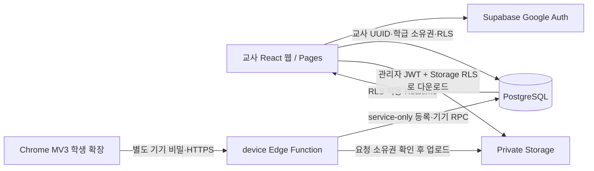

# 실제 연결 아키텍처

이 문서는 현재 운영 진입점의 구조다. 이전 가상 화면은 `src/demo/`, 설치 진단만 하던 확장은 `reference/installation-prototype/`에 보존했으며 운영 import 경로에서 제외했다.

## 교사와 학생의 인증은 다르다

교사는 공통 정적 웹에서 자기 Supabase URL/공개 키를 브라우저에 저장한다. 공용 로그인·회원 DB는 없고 Auth·DB·Storage·Edge 사용량도 각 프로젝트에 속한다. VITE에 과거 프로젝트 설정이 있어도 기본 연결로 사용하지 않는다. Google 인증 후 개인 프로젝트의 app_admins에 본인 UUID를 수동 지정한 소유자만 app_enroll_teacher()로 자기 회원을 만들 수 있다. 최종 ③ SQL의 app_is_teacher()는 소유자이면서 active 회원임을 요구한다. 학급 소유권 RLS와 RPC·Storage도 이 조건을 따른다. Edge Function은 auth.getUser() 후 app_teachers와 app_admins를 모두 확인하고 소유 학급만 처리한다. ② SQL의 공용 교사 회원 구조는 마이그레이션 중간 단계이며 ③을 생략하면 개인 프로젝트 권한이 완성되지 않는다. 현재 웹은 ④ 보안 SQL의 버전 RPC를 확인한 뒤 데이터 화면을 연다.

프로젝트 전환 전 현재 SDK의 로컬 로그아웃과 자동 갱신 중단을 하고 연결 설정을 지운다. 현재 설정으로 학생 ZIP의 API 주소를 생성하며 기존 학생/기록을 다른 프로젝트에 자동 이관하지 않는다. 로그인 유지 토큰은 브라우저 저장소에 있으므로 배포 코드/XSS 침해는 개인 프로젝트에도 영향을 줄 수 있다.

학생은 Auth 관리자 계정으로 로그인하지 않는다. 공통 ZIP의 API 주소로 참여 코드·번호·이름과 기기 생성 256비트 비밀을 전송한다. 서버는 코드 만료·사용 횟수·등록 빈도·교사별 99명 제한을 확인하고 pending 학생/기기를 생성한다. DB에는 기기 비밀의 SHA-256만 보관한다. 교사 승인 전에는 pending 상태와 자기 식별 정보만 반환한다. 승인 후에도 기기는 자신의 명령·상태만 받으며 학생 목록·이력·캡처를 읽는 DB JWT나 관리자 키를 받지 않는다.

등록 요청 재전송은 같은 기기 비밀을 기준으로 동일 학생을 복구한다. 관리자 정보 수정은 같은 학생 ID를 유지한다. 폐기된 기기는 이후 API가 거절되며 재등록은 새 비밀과 승인 절차가 필요하다.

## 실제 데이터와 화면

`app_classes`, `app_students`, `app_latest_commands`의 실제 값을 조회한다. 비어 있으면 빈 화면을 보여준다. 학생의 최근 수신 시각이 120초 이내이고 승인 상태가 active일 때 접속 중으로 계산한다. 기록 OFF에서는 새 방문 이력 쓰기를 중단하되 기존 정보와 기기 제어는 유지한다.

학생/명령/학급 변경은 Supabase Postgres Changes를 구독한다. 250ms 묶음 갱신과 15초 재조회가 연결 복구를 보조한다. 연결 실패는 교사 화면의 서버 오류로, 특정 기기의 명령 실패는 해당 카드의 간단한 오류로 구분한다. 권한은 로그인 후와 60초 주기로 재확인한다.

학생 상세는 최근 방문 100건·이벤트 100건·유효 캡처 20건을 제한 조회한다. 모든 조회는 관리자 RLS에 종속된다.

## 명령의 순서와 완료

교사가 명령을 요청하면 `app_issue_commands`가 학생별 행 잠금을 사용하여 revision을 부여한다. 같은 학생/request_id는 중복 생성하지 않는다. 최신 해제는 전달 대기 중인 이전 잠금을 superseded로 바꾸며 늦은 ACK도 이를 되돌릴 수 없다.

상태는 queued → delivered → applied 또는 failed다. 기한 내 확인되지 않으면 expired로 취급한다. UI는 queued/delivered를 성공으로 표시하지 않는다. 학생별 기기 RPC는 다른 학생 ID의 ACK를 수정할 수 없다. 잠금·해제의 최신 revision과 desired lock 상태를 별도 반환하므로 워커 재시작 후에도 최신 상태로 동기화한다.

학생 확장은 동기화를 단일 실행 Promise로 묶고 통신 오류에는 지수 백오프와 jitter를 사용한다. 활성 페이지/탭 이벤트에서는 수 초, 휴면 중에는 30초 alarms가 보조한다. setInterval이 MV3 워커를 영구 유지한다고 가정하지 않는다. 기기 ACK는 실행 확인 후 즉시 전송하며 전송이 실패하면 큐에 남겨 재전송한다.

## 잠금 안전성

검은 Chrome 전체 화면 팝업을 사용한다. OS 전체 잠금은 아니다. 생성 중 해제·창 ID 변경·재시작을 확인하고 분당 3회 이상 반복 재생성하지 않는다. 창 생성·해제 상태 쓰기는 직렬화한다.

서버가 응답해도 잠금 기한을 넘기지 않고, 정상 제어 응답이 끊기면 로컬 lease 최대 120초 후 안전 해제한다. 로컬 시각 역전도 해제 방향으로 처리한다. 교사가 발급한 무작위 비상 코드의 해시가 동기화되어 있으면 오프라인 검증으로 해제할 수 있다. 로컬 긴급 해제한 revision은 재접속으로 다시 잠기지 않으며, 새 교사 잠금 revision만 허용한다. 복구 코드는 기기 관리자 권한이나 OS 보안 경계가 아니다.

## 기록·캡처

활성 탭 샘플의 누적 체류시간과 visit ID를 저장소에 유지한다. 워커가 재시작되어도 같은 방문은 이어지며 긴 절전 공백을 무한히 더하지 않는다. URL 사용자 정보·query·fragment는 제거한다. offline 큐는 최대 50개 방문으로 제한한다. 정확한 활성/유휴 추정은 ChromeOS 절전·포커스 테스트가 필요하다.

캡처는 해당 기기의 유효한 capture 명령이 있을 때만 서버가 수락한다. 확장은 잠금 여부와 활성 탭을 캡처 전후 검증한다. 서버는 학생/명령 소유권·만료·이미지 형식·3MB 제한을 확인하고, 먼저 uploaded=false 만료 메타데이터를 예약한 뒤 비공개 버킷에 바이트를 저장한다. app_complete_capture 서비스 전용 RPC가 승인·폐기·기한을 재확인하여 uploaded=true와 applied 결과를 한 트랜잭션에서 확정한다. 예약 중인 파일은 Storage RLS로 읽을 수 없다. 교사 웹은 JWT 인증 다운로드 후 로컬 Blob URL로 표시하며 공개/서명 파일 링크를 만들지 않는다. Storage RLS는 학급 소유 교사와 아직 만료되지 않은 메타데이터를 모두 요구한다.

보관 기간은 학급별로 설정하고 관리자 정리 함수로 만료 파일·방문·이벤트를 삭제한다. 예약 실행은 아직 구성하지 않았다. 따라서 보관 설정만으로 모든 파일이 즉시 물리 삭제되는 것은 아니다.

## 외부에 아직 적용하지 않은 것

사용자 Supabase/Google OAuth 프로젝트와 Pages에 이 코드가 자동 배포된 것은 아니다. 기본/교사 회원가입/개인 프로젝트 SQL·함수 배포·OAuth 제공자·개인 소유자 지정은 [설치 안내](SETUP.ko.md)를 따라 적용해야 한다. 실제 ChromeOS 동작·지연·99대 네트워크 부하·학교 정책은 [실기기 체크리스트](CHROMEOS.ko.md)로 검증한다.

## 공지의 격리와 이전 버전 차단

공지 본문은 방문 웹페이지의 콘텐츠 스크립트로 보내지 않는다. notice.html은 외부 공개 리소스로 등록하지 않은 확장 전용 팝업이다. 정확한 확장 URL·공지 UUID·발신 탭/창을 확인해 본문을 주고, 해당 창의 렌더링 확인 후 ACK한다. 콘텐츠 스크립트는 POLL 깨우기만 한다. 새 API와 ④ SQL은 보안 프로토콜 2가 없는 구형 요청을 거부한다. 프로토콜 표식은 소프트웨어 업데이트 확인용이며 악성 기기의 무결성을 증명하는 인증 수단은 아니다.

1.2.0은 HTTP(S) 기록과 별개로 Chrome API가 노출한 카메라·파일·설정 등 일부 내부 주소를 허용 목록으로 처리한다. 경로와 제목 원문 대신 고정된 앱 이름/루트 주소만 저장하며 임의 확장·알 수 없는 OS 앱은 기록하지 않는다. 내부 앱은 캡처 대상이 아니다. 카메라 앱이 API에 실제 노출되는지는 기기별 검증이 필요하다.
